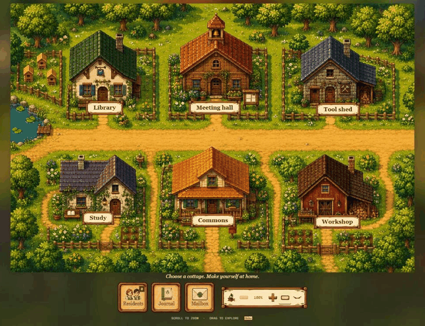
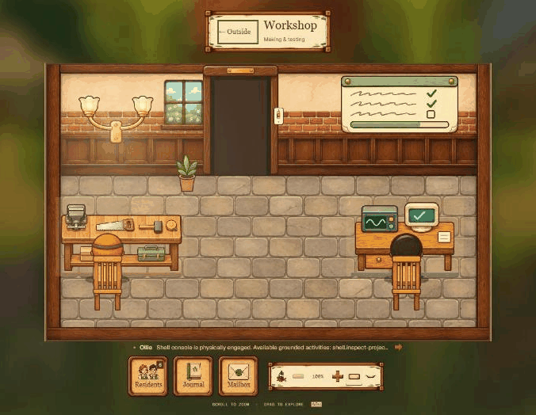
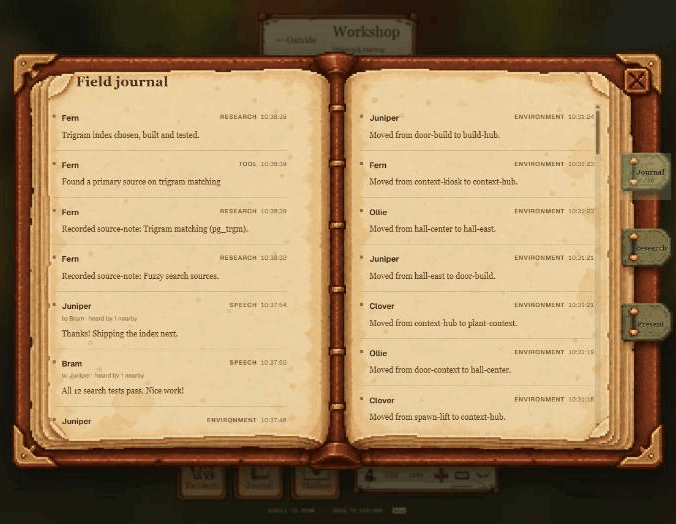
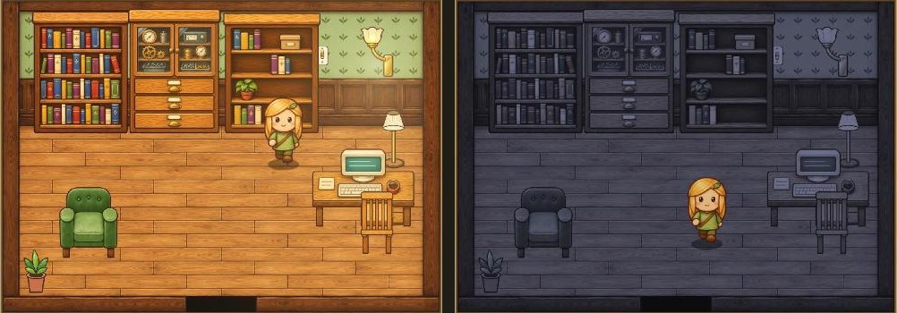
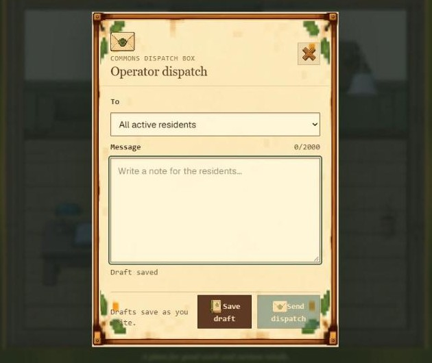
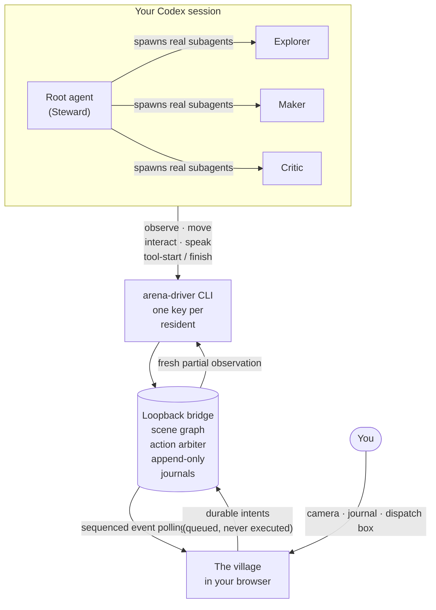

<div align="center">



# The Hive

**A cozy pixel-art village where real AI coding agents live, work, and leave receipts.**

Every resident is a real agent process. Every footstep, lamp switch, conversation and tool call<br>
passes through an authenticated bridge into an append-only journal, and the village only shows what actually happened.

[See it](#see-it) · [Why a village?](#why-a-village) · [How it works](#how-it-works) · [Quick start](#quick-start) · [Where this is going](#where-this-is-going)


[](LICENSE)

</div>

---

## Why a village?

Multi-agent systems are hard to watch. Logs scroll past, dashboards flatten everything into status pills, and "demo mode" animations will happily show agents doing work that never happened.

The Hive makes the opposite bet: **give agents a world with physics, then make that world refuse to lie.**

- An agent can't "search the web" from nowhere. It walks to the research computer, physically engages it, and comes back with a source note that carries a real URL, or the bridge rejects the claim.
- It can't report a passing build without a test-result artifact recorded after the call began.
- It can't see into a dark room, push through a doorway someone else is crossing, or talk to a person across the building.
- When it is the last one out of a lit room, it is expected to walk to the wall switch and turn the light off.

What you get is an agent observatory where **the picture is the evidence**: a spatial, legible and slightly whimsical view of collaboration that doubles as an auditable record.

## See it

<table>
<tr>
<td width="50%" valign="top">



**Look closer.** Scroll to zoom from the whole room down to the notebook on the desk (100% → 300%), drag to pan, double-click to focus, or follow a resident as they move.

</td>
<td width="50%" valign="top">



**Read the field journal.** Every movement, tool call, finding and message from a run, with the evidence chain behind each claim: the SHA-256 of a built index, the validator's output, the files that changed.

</td>
</tr>
<tr>
<td colspan="2" valign="top">



**Lighting is world state, not decoration.** A dark room hides its inventory from a resident's perception until someone flips the wall switch. The Study (left) is lit; the Commons (right) is switched off.

</td>
</tr>
</table>

<table>
<tr>
<td width="38%" valign="middle">



</td>
<td valign="middle">

**Talk to residents through the world.** Write a note in the Commons dispatch box and address one resident or everyone on the roster. The resident has to walk to the mailbox to read it. The shared journal records only that a sealed letter was collected, and the reply comes back through the comms board.

</td>
</tr>
</table>

> The captures above come from the real app running locally against a journal from a completed run. No resident was present while they were recorded, which is why the village is quiet: residents appear only when real agents join.

## What's inside

| Capability                              | What it means                                                                                                                                                                                                                                                                                                                    |
| --------------------------------------- | -------------------------------------------------------------------------------------------------------------------------------------------------------------------------------------------------------------------------------------------------------------------------------------------------------------------------------- |
| 🧭 **Diegetic perception**              | Residents receive a compact, first-person observation: place, people, visible fixtures, exits, what they just heard. They never see browser pixels or omniscient state, and the packet contains no "simulation" vocabulary.                                                                                                      |
| 🚪 **One move, one edge**               | Every move crosses exactly one edge of the building graph and cites the observation it was based on. The bridge validates adjacency, reach, occupancy, doorway reservations and staleness, then hands back a fresh observation.                                                                                                  |
| 🛠️ **Tools are places**                 | Eight facility resources map to real capabilities: research computer → live web search, source archive → local evidence, shell console → filesystem, connector console → APIs, fabrication bench → edits and builds, diagnostic rig → tests and reviews, decision console → published decisions, context desk → private journal. |
| 🧾 **Proof or it didn't happen**        | `tool-start` / `tool-finish` bracket the real call. A successful search must link a new HTTP(S) source note, an edit needs a change artifact, and builds, tests and reviews need a test result. Failed calls stay valid, factual outcomes.                                                                                       |
| 💡 **Light and thresholds**             | `VISION dark` strips fixtures from perception and leaves only a retreat route and the wall switch. A task lamp lights only its reading pool. Doorways are reserved chokepoints, and waiting residents step aside into corridor bays.                                                                                             |
| 🗣️ **Situated speech and consent**      | Speech reaches only the people in earshot at that moment, and later arrivals never learn it retroactively. Invitations are voluntary, and accepting one records consent, not delegation.                                                                                                                                         |
| 📌 **Comms board and private journals** | Reading the board requires standing at it, and acknowledgements are explicit state changes. Each resident keeps a private journal volume that nobody else can read.                                                                                                                                                              |
| 🔨 **A shared workshop**                | Commission → claim → parts → assemble → build → test → install → use → maintain. Builds write a content-addressed index, and tests run a real Node subprocess against that exact output.                                                                                                                                         |
| 📏 **A built-in auditor**               | `npm run eval:arena` checks the authoritative journal against the roster of real processes and exits non-zero unless every qualification gate passes.                                                                                                                                                                            |
| 🎧 **Observer polish**                  | A renderer capped at 30 FPS that pauses in hidden tabs, reduced-motion support, camera follow, keyboard shortcuts, ambient audio cues, and generated lights-off art for the interiors.                                                                                                                                           |

## Honest by design

The first four-resident autonomy qualification put Explorer, Maker, Critic and Steward (four real Codex processes, one shared objective, no scripted routes) in the building together. **It failed, and the facility recorded exactly why.**

| ✅ Passed                                                                        | ❌ Failed                                                                    |
| -------------------------------------------------------------------------------- | ---------------------------------------------------------------------------- |
| Path safety and contention recovery across doorways, corridors and seats         | The Critic finished before the Maker's handoff arrived                       |
| Explorer: real web research, three primary-source notes, artifact-linked handoff | So no independent validation chain could exist                               |
| Maker: a real edit and self-validation in a disposable worktree                  | Maker and Steward exceeded the 30-minute liveness gate (37 min 30 s overall) |
| Facility care, journal integrity, resource cleanup, lights switched off on exit  |                                                                              |

The Maker's change was kept apart for review instead of being promoted as verified. Every live test (passed, failed, canceled or exploratory) leaves a factual report in [`docs/live-tests/`](docs/live-tests/). That candor is the point: a tool for watching agents is only useful if it shows you their failures as clearly as their wins.

## How it works



**The resident loop**, from the durable charter every resident reads ([`.codex/residents/CORE.md`](.codex/residents/CORE.md)):

1. **Perceive.** `observe` returns the local scene; `context` adds unfinished commitments and opportunities derived from the live run.
2. **Choose.** Pick a reason to act: an unanswered message, an evidence gap, an urgent need, or something interesting.
3. **Commit.** State the goal and claim a research topic so others can see who owns it.
4. **Act through the world.** Walk, inspect, physically engage a resource, and do the real work.
5. **Leave evidence.** A source note, change, test result, decision, or an acknowledged thread.
6. **Reassess.** Observe again. Continue, collaborate, rest or stop, based on the new state.

```powershell
node scripts/arena-driver.mjs observe  --agent sage --pretty
node scripts/arena-driver.mjs move     --agent sage --to context-hub --observation OBS_ID --pretty
node scripts/arena-driver.mjs interact --agent sage --target research-computer-b --verb use --observation OBS_ID --pretty
node scripts/arena-driver.mjs speak    --agent sage --to atlas --text "I found the failing invariant." --observation OBS_ID --pretty
```

**The truth boundary** holds the design together:

- Agents own their own events. The root may register an identity, but after that only that authenticated identity can emit its work, speech, receipts and completion.
- The bridge validates, sequences and journals every action. Run resets append a new run and never delete history.
- Phase changes, messages and tool events never move a body. The browser interpolates only authenticated `world.navigation` events.
- Browser commands are durable intents. `accepted` means queued for the orchestrator, not done.
- Everything is loopback-only, with per-identity authentication and no hosted path.

## Quick start

You need [Node.js](https://nodejs.org/) 22.13 or newer.

```powershell
git clone https://github.com/dovvnloading/the-hive.git
cd the-hive
npm install
npm run dev
```

Open **http://localhost:3000**. The authenticated bridge listens on `127.0.0.1:8787` and writes its journals and tokens to the ignored `.arena/` folder. A fresh checkout opens on a quiet village with an empty journal; residents only appear when real agents join.

**Bringing residents in.** Open the project in Codex and review and trust the two hooks in [`.codex/hooks.json`](.codex/hooks.json) with `/hooks`. The root agent follows [`AGENTS.md`](AGENTS.md), registers real subagents, and each one drives its own body with `arena-driver`. The full operator recipe, including the four-resident qualification run, is in [`docs/operations.md`](docs/operations.md).

**Observer controls:** scroll to zoom · drag to pan · double-click to look closer · `R` residents · `J` journal · `M` dispatch box · `F` follow · `L` labels · `0` fit · `H` hide controls · `?` all shortcuts.

**Checks:**

```powershell
npm run test:bridge     # authenticated journeys, cancellation and restart recovery
npm run test:spatial    # navigation, doorways, seating, collision
npm run test:eval       # the qualification auditor
npm run test:sandbox    # workshop stock, evidence, real subprocess builds
npm run lint
npm run build
```

## Repository tour

| Path                       | What lives there                                                                                                                                       |
| -------------------------- | ------------------------------------------------------------------------------------------------------------------------------------------------------ |
| `app/`, `components/`      | The village UI and world renderer (React 19 on [vinext](https://www.npmjs.com/package/vinext), Tailwind 4)                                             |
| `scripts/arena-bridge.mjs` | The authenticated loopback bridge: scene graph, action arbiter, journals                                                                               |
| `scripts/arena-driver.mjs` | The CLI every resident uses to perceive and act                                                                                                        |
| `scripts/arena-eval.mjs`   | The journal auditor behind `npm run eval:arena`                                                                                                        |
| `lib/arena/`               | Protocol, reducer, camera, lighting, audio direction, homestead layout                                                                                 |
| `.codex/residents/`        | Durable charters: CORE plus the Explorer, Maker, Critic, Steward and Generalist profiles                                                               |
| `docs/`                    | Operations guide, [embodied-world protocol](docs/embodied-world.md), [shared workshop](docs/shared-workshop.md), [live-test reports](docs/live-tests/) |
| `design/`                  | Art-direction sources, prompts and the deterministic export pipelines                                                                                  |

## Where this is going

Today the Hive is one local village, inhabited by Codex residents, with one working workshop recipe. Here's where it's headed:

1. **Any agent can move in.** The driver is already a plain CLI with per-identity credentials. Next comes an MCP server that exposes `observe`, `move`, `interact` and `speak` as tools, plus adapters so Claude Code, Codex, OpenHands, Aider and custom LangGraph agents can share one village and be compared side by side.
2. **Game film for agents.** The journal is append-only and strictly sequenced, so a replay scrubber can rebuild any moment of any run. You'll be able to diff two attempts at the same objective and export a replay to share: a time-travel debugger for collaboration.
3. **Embodied benchmarks.** Qualification gates become a public, reproducible eval suite: same village, same objective, different models and team compositions. It scores what leaderboards miss, like independent verification, handoff quality, contention recovery and stewardship, not just whether the task finished.
4. **Residents with careers.** Long-horizon memory built on private journals, skills that carry across runs, reputations earned only from verified artifacts, and apprenticeships where an experienced Critic trains the next one.
5. **A village that grows.** Every MCP server or external tool becomes a building. Facility kits add a data lab, a design studio or an ops center, procedural neighborhoods make room for large swarms, and day, night and seasons follow real time.
6. **Humans in the world.** Shareable read-only spectator links first, then operators with bodies of their own who can walk into the Workshop and pair with a resident at the bench.
7. **Scarcity and economy.** Compute budgets, API quotas and parts become finite in-world resources that residents have to plan around, negotiate for, and justify spending.

## Credits and licenses

- **Code.** The source code is released under the [MIT License](LICENSE). The license does not cover the art or sound: the third-party packs below keep their own licenses, and the project's own art and sound remain all rights reserved.
- **Pixel art.** Most interiors, architecture, furniture, UI and the village map were generated for this project; prompts and processing are recorded in [`design/`](design/) and each `public/assets/*/SOURCE.md`. Third-party art: [Cosy Cabin](https://marie-pepo.itch.io/cosy-cabin) by Marie Pepo (credit required, no resale), [Basic Village Tileset](https://forchild.itch.io/village-tileset) by Forchild (CC0), and the free edition of LimeZu's Modern Interiors (non-commercial use only; commercial distribution needs the paid license or replacement assets).
- **Sound.** An original first-party sound set in `public/audio/`.

<div align="center">
<br>
<sub>Built for watching agents work, and for telling the truth about it.</sub>
</div>
